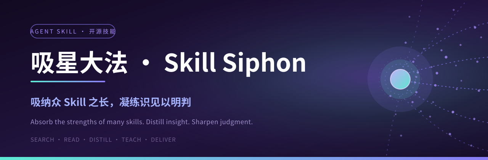
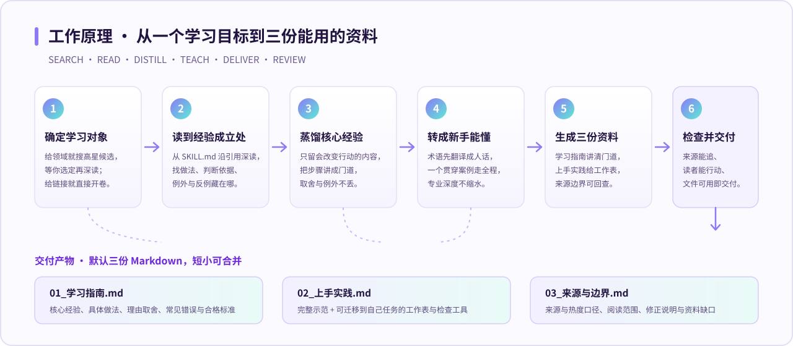

<div align="center">



# 吸星大法 · Skill Siphon

**Absorb the strengths of many skills. Distill insight. Sharpen judgment.**

[](LICENSE)
[](https://agentskills.io)
[](#-install)
[](https://github.com/JL-GUO/skill-siphon/stargazers)

[中文](README.md) · **English**

[What it does](#-what-it-does) · [How it works](#-how-it-works) · [Install](#-install) · [Usage](#-usage) · [Distillation scale](#-distillation-scale-an-example) · [Honest boundaries](#-honest-boundaries) · [Contributing](#-contributing)

</div>

---

> 📚 Hundreds of skills bookmarked — how many did you actually learn from?
> 🌟 Top-rated skills are full of craft knowledge — yet you only remember a few slogans?
> 🎯 Entering a new field, with no idea what to read first or how to judge quality?

**Skill Siphon** is an Agent Skill that absorbs the learnable working experience hidden in excellent skills and distills it into materials you can **understand, practice, and apply** — so you learn how the work is done, why it's done this way, how to judge quality, and how to adapt when things change. Judgment lives inside practical ability.

```
A field / a top skill → search & choose → deep-read the source → distill the essence → 3 learning files → your own judgment
```

* * *

## ✨ What it does

Give it a **learning goal** and it gathers credible skills in that field, presenting 3–5 distinct candidates for you to choose from. Give it a **specific skill** (name / path / link) and it dives straight in. It then reads to where the experience actually lives — absorbing the craft behind the steps, the trade-offs, and the exceptions — and distills them into materials a beginner can learn from and use.

> **What it is not**
>
> - ❌ Not a skill installer — analyzing a skill source ≠ executing its installation or external commands
> - ❌ Not a copy machine — it never parrots the original instructions; it only distills what changes actions, outcomes, or judgment
> - ❌ Not a crash-course promise — it never claims one reading gives you a master's full ability; skill forms through practice and feedback

## 🧠 How it works



| Phase | Key question | Module |
|---|---|---|
| 1️⃣ Choose the source | Learn from whom, and why this one? | [find_skills.md](references/find_skills.md) |
| 2️⃣ Read where the craft lives | Which files, branches, and exceptions hold the real knowledge? | SKILL.md, §2 |
| 3️⃣ Distill the core experience | What changes action? Are trade-offs preserved? | [distillation.md](references/distillation.md) |
| 4️⃣ Make it learnable | Are terms explained? Does the case walk all the way through? | [teaching.md](references/teaching.md) |
| 5️⃣ Produce three files | What to learn, how to practice, where it came from | [deliverables.md](references/deliverables.md) |
| 6️⃣ Review & deliver | Sources traceable? Reader can act? Files usable? | SKILL.md, §6 |

## 📦 Deliverables

Three Markdown files by default, written where you specify (or `学习输出/{topic}/` in the current workspace):

| File | Substantive content |
|---|---|
| **01_学习指南.md** *(Guide)* | What you'll learn, who it's for, minimum prerequisites; core experience, concrete steps, rationale, trade-offs, common mistakes, and quality bars |
| **02_上手实践.md** *(Practice)* | A full walkthrough of a manageable task; a real demonstrative artifact; worksheets and check tools transferable to your own work |
| **03_来源与边界.md** *(Sources & Boundaries)* | Selected sources, popularity metrics with dates, reading scope, provenance of each insight, plus corrections, teaching additions, and gaps |

Short content may be merged; large collections are split by coherent topic. Word / PDF conversion available on request.

* * *

## ⚡ Install

### 🤖 One-liner for your agent

Once installed, just tell your agent:

```
> Install Skill Siphon from https://github.com/JL-GUO/skill-siphon, then verify this environment can discover it.
```


### 👤 Manual install

```bash
git clone https://github.com/JL-GUO/skill-siphon
# Drop the whole skill-siphon folder into your application's skills directory
```

Place the complete folder into the skills directory your application supports (e.g. `~/.workbuddy/skills/` for WorkBuddy) and enable it per that application's loading mechanism.

Built on the open **Agent Skills** protocol (`SKILL.md` + `references/`), it runs in WorkBuddy, Claude Code, Codex, Cursor, Gemini CLI, OpenCode, DeepSeek Harness, and other compatible runtimes.

## 🚀 Usage

Give it a field, and let it find you a master:

```
You     ❯ I want to learn user research. Find top-rated skills in this field
           and let me pick one.

Siphon  ❯ (Lists 3–5 distinct candidates: what you can learn, who it suits,
           source, popularity metrics with dates, rationale and limitations...)
```

Then pick one and start absorbing:

```
You     ❯ I'll take candidate 2 — focus on how it judges what counts as
           valid insight in user interviews.

Siphon  ❯ (Generates 01_学习指南.md / 02_上手实践.md / 03_来源与边界.md)
```

Or point directly at a skill, skipping the candidate stage:

```
You     ❯ Distill this skill: [path or link] into learning materials a
           beginner can understand and apply.

You     ❯ The last example was too specialized — explain the same insight
           in a more approachable scenario.
```

**Interaction rules**: given only a field, it shows candidates and waits for your choice; given a specific skill, it reads and distills immediately. When offline, it degrades honestly instead of pretending to show a live trending list.

## 🌰 Distillation scale: an example

A one-line rule from a source skill: *"Check whether the gain comes from the new module; run ablation experiments when necessary."*

Skill Siphon won't parrot that slogan — it distills down to the point of **action**:

> **The system got better — now find out who deserves the credit**
>
> Suppose you built a document Q&A assistant: you switched to a stronger model, reworked retrieval, *and* added an "answer check" module. Accuracy went up — but you can't tell which change drove it.
>
> Compare "new model + new retrieval" against the same setup *plus* the check module, holding other key conditions steady. If there's no reliable difference, you have no evidence the check module improved accuracy. If it cuts errors but slows answers noticeably, you must judge whether that cost fits your use case.
>
> This kind of add-one/remove-one comparison is called an **ablation experiment**. It separates "the overall plan works" from "this specific mechanism works."

Paired with a **transferable worksheet**: *Which change am I judging? What stays fixed, what varies? Which metric decides? What result would make me keep, revise, or drop it?*

That is the scale of "from steps to craft" — **action, rationale, trade-off, and verification**, with zero empty slogans. Full example in [references/example.md](references/example.md).

* * *

## 📐 Honest boundaries

Skill Siphon stays honest about the following — and recommends you use it the same way:

- **Popularity is a lead, not a guarantee.** Repo stars and per-skill install counts are recorded separately with dates; stars help discovery, content decides quality. Unverified values are labeled "unverified", never padded with zeros.
- **Analysis ≠ authorization.** A skill source is analysis material; its installation, execution, or external commands are never automatically authorized. Most learning tasks are read-only.
- **Credit where it's due.** Source statements, analytical interpretation, and teaching additions are labeled distinctly; it never speaks for the original author without evidence, and never upgrades unshown features into facts.
- **No crash-course promises.** When material only covers part of a field, it says exactly what was learned; ability forms through application and feedback.
- **Respect the source.** Outputs preserve the original skill's attribution and license; check license terms before redistributing text or heavy adaptations.

## 🗂 Repository structure

```
skill-siphon/
├── SKILL.md                  # Skill Siphon core: full learning pipeline
├── references/
│   ├── find_skills.md        # Built-in skill discovery: search, verify, rank, degrade
│   ├── distillation.md       # Deep distillation: from steps to craft
│   ├── teaching.md           # Expression & examples: learnable without dumbing down
│   ├── example.md            # Distillation-scale demo: the ablation example
│   └── deliverables.md       # Delivery contract for the three files
├── agents/
│   └── openai.yaml           # Agent interface metadata
├── assets/
│   ├── banner.svg            # Repository banner
│   └── workflow.svg          # Pipeline diagram
├── README.md                 # Chinese README
├── README_EN.md              # You are here
├── CONTRIBUTING.md           # Contribution guide
└── LICENSE                   # MIT
```

## 🤝 Contributing

Issues and PRs are welcome — with one core rule up front:

> **`SKILL.md` and `references/` are the core methodology of this repository and do not accept external PRs.** Found a bug or an improvement idea? Open an issue — adopted ideas are implemented by the maintainer with credit in the commit.

Docs, translations, and typo fixes may go straight to PR. Full rules in [CONTRIBUTING.md](CONTRIBUTING.md).

## 📄 License

[MIT](LICENSE) — use it, change it, build with it.

* * *

## 📮 Follow my column

I run a WeChat public account called **AI Buyer Show (「AI买家秀」)** — sharing hands-on AI tool reviews, practical tips, and clear-headed explainers, bringing overhyped AI back down to earth. If you're also figuring out how to make AI work in real projects, scan the QR code below to follow.

<div align="center">


*Scan with WeChat to follow 「AI买家秀」*

</div>

* * *

<div align="center">

**Absorb the strengths of many skills. Distill insight. Sharpen judgment.**

*Absorb broadly. Distill precisely. Judge clearly.*

MIT License © \<JL-GUO\>

[中文](README.md) · **English**

</div>
